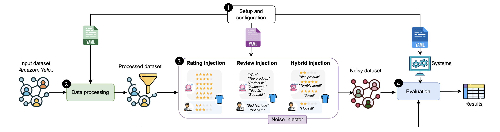

# RecProbe: A Data Perturbation Framework for Robustness Analysis of Recommender Systems
This paper is currently under review at the journal Expert Systems with Applications.


The perturbed Amazon Reviews and Yelp datasets are available [here](https://figshare.com/s/6c1251b43d45552cfd24) together with all the dataset statistics.

**RecProbe** is a framework for measuring how recommender systems behave when their training data contain defects. It injects controlled, reproducible perturbations into the interactions, ratings and reviews of a dataset, stores the perturbed dataset as a reusable artifact, and evaluates the same models on clean and perturbed data, with accuracy and beyond-accuracy metrics, multiple random seeds and user segments.

# :bookmark: Outline
1. [Before starting](#airplane-before-starting)
2. [Configuration](#screwdriver-recprobe-configuration)
3. [Installation and usage](#whale-installation-and-usage)
4. [Outputs](#file_folder-outputs)
5. [Customization](#wrench-customization)
6. [Tests](#white_check_mark-tests)


# :airplane: Before starting
## What is RecProbe?
RecProbe systematically perturbs user–item feedback datasets and evaluates how recommendation models respond to realistic defects. Perturbations are grounded in a taxonomy of data defects that classifies each defect along two dimensions:

- **corrupted signal**: the field of the feedback record that is altered (interaction, rating or review);
- **observability level**: the minimum information needed to detect the defect:
  - *point*: the field is invalid on its own;
  - *contextual*: the field is valid but inconsistent with other evidence (the paired field, the user's history, the item's feedback);
  - *collective*: no single record is irregular, the defect emerges only from a pattern across records.

The taxonomy describes properties of the data, not the intent behind them: the same defect may come from careless users, data-entry errors or deliberate attacks.

| Corrupted signal | Point anomaly | Contextual anomaly | Collective anomaly |
|---|---|---|---|
| :link: **Interaction** (all methods) | `invalid_timestamp` | `sequence_corruption` | `interaction_burst`, `interaction_shilling` |
| :star: **Rating** (explicit-feedback methods) | `invalid_rating` | `history_inconsistent_rating`, `rating_flip` | `rating_burst`, `rating_shilling` |
| :abcd: **Review** (review-aware methods) | `uninformative_review`, `off_topic_review` | `context_swap`, `sentiment_flip` | `review_burst`, `review_shilling` |

- :link: **Interaction level**
  - *Invalid or placeholder timestamp*: timestamps outside the admissible range of the platform or encoding a missing value (future dates, the Unix epoch, sentinel values, dates before the platform existed).
  - *Sequence corruption*: interactions that are valid in isolation but inconsistent with the user's history, inserted inside the user's chronological sequence (e.g. an accidental click on a blockbuster in a sequence of niche films). Inconsistency is measured by item co-occurrence, popularity or category.
  - *Burst*: many interactions on the same target items within a short time window, from existing or fake users.
  - *Shilling*: a group of coordinated fake profiles interacting with the same target items, with filler interactions (random, popular or within a segment) that make each profile plausible.
- :star: **Rating level**
  - *Invalid or placeholder rating*: ratings out of range, of the wrong granularity (e.g. 3.7 on an integer scale) or placeholders for missing values.
  - *History-inconsistent rating*: ratings far from the user's rating history or from the ratings the item usually receives.
  - *Rating flip*: the rating polarity is reversed (5 → 1, 4 → 2), so it no longer matches the review.
  - *Burst*: a wave of ratings on target items within a short window, shifting their rating distribution.
  - *Shilling*: random, average, bandwagon, segment and love/hate attacks, pushing or nuking the target items.
- :abcd: **Review level**
  - *Absent or uninformative review*: missing, truncated or content-free text ("ok", ".").
  - *Off-topic content*: text about shipping, delivery or the seller instead of the product.
  - *Context swap*: a well-formed review that does not match the reviewed item (e.g. hiking boots described as perfect for the beach).
  - *Sentiment flip*: the review text expresses the opposite sentiment of the rating, which is left unchanged.
  - *Burst*: a review-bombing campaign of LLM-generated reviews on target items within a short window.
  - *Shilling*: a fake reviewer group with LLM-generated target reviews and plausible filler reviews.

Two general-purpose operations are also available, outside the taxonomy: `record_removal` (data incompleteness, sparsity) and `metadata_modification` (timestamp changes).

Run `python main.py --list` to print the full list with a short description of each perturbation.

## Pipeline


**1. Setup and configuration.** Each phase of the pipeline is configured by a YAML file: one for data processing, one for the injection and one for the evaluation. The files can be written by hand or generated by the web interface.

**2. Data processing.** The input dataset is loaded, the fields are mapped onto the RecProbe schema and the data are filtered (duplicate removal, rating range, minimum review length, k-core). The data are then split into training, validation and test sets.

**3. Defect injection.** The configured perturbation is applied, by default to the training set only. The perturbed dataset is saved together with a log of every record that was added, modified or removed.

**4. Evaluation.** The selected models are trained and evaluated on the clean and on the perturbed dataset, over multiple seeds. RecProbe reports accuracy and beyond-accuracy metrics for the whole population and for each user segment in a single comparison table.


# :screwdriver: RecProbe Configuration
All the code lives in the `src/` folder, and RecProbe is run from there. In this README, file paths are relative to `src/` (e.g. `config/files/data.yaml` is `src/config/files/data.yaml`), and so are the relative paths written in the YAML files.

:warning: *This section explains how to write the YAML files by hand. If you plan to use the web interface, jump to [Installation and usage](#whale-installation-and-usage).* :warning:

The three configuration files are:

| Phase | Default file | What it defines |
|---|---|---|
| Data processing | `config/files/data.yaml` | input and output files, field mapping, filters, split |
| Defect injection | `config/files/injection/<perturbation>.yaml` | the perturbation and its parameters |
| Evaluation | `config/files/evaluation.yaml` | library, models, metrics, segments, seeds |

Every file only needs the values that differ from the defaults.

### Input and output
RecProbe reads one file in **CSV**, **JSON** or **JSONL**. The fields are:

- `user_id`: the id of the user (**required**)
- `item_id`: the id of the item (**required**)
- `timestamp`: the time of the interaction, as Unix seconds/milliseconds or a date string (optional)
- `rating`: the numerical rating (optional)
- `review_text`: the textual review (optional)

Perturbations that need a missing field (e.g. `rating_flip` without ratings) stop with an explicit error.

**Amazon Reviews 2023** (and its subsets, also with the older 2018 field names) and **Yelp** are supported out of the box: set `source: amazon` or `source: yelp` in `data.yaml`. For a custom dataset, set `source: custom` and, if its columns have different names, map them with `fields`:

```yaml
dataset: my_dataset
source: custom
input:
  reviews:
    path: ./data/input/my_dataset
    file_name: reviews          # reviews.csv / reviews.jsonl / ...
    format: csv                 # csv | json | jsonl
    separator: "\t"
  items:                        # optional item metadata (category, title)
    path: ./data/input/my_dataset
    file_name: items
    format: jsonl
fields:
  user_id: reviewer
  item_id: product
  rating: stars
  review_text: body
  timestamp: date
output:
  reviews:
    path: ./data/output/my_dataset
    format: csv
```

Item metadata are optional. When available, the item categories and titles are used by `context_swap`, by the `category` strategy of `sequence_corruption`, by segment fillers in shilling attacks and in the LLM prompts.

Place the original dataset in `src/data/input/<dataset>/`. The processed and the perturbed datasets are written to `src/data/output/<dataset>/` (see [Outputs](#file_folder-outputs)).

### Data processing (`data.yaml`)
```yaml
kcore: 3                       # iteratively remove users/items with fewer than k interactions
min_rating: 1                  # keep ratings in [min_rating, max_rating]
max_rating: null
min_review_length: 0           # minimum number of tokens of a review
drop_duplicates: true          # one record per (user, item), the most recent one
split:
  training: 0.8
  validation: 0.1
  test: 0.1
  strategy: random_holdout     # random_holdout | temporal_leave_one_out | global_temporal | random_leave_one_out
  split_timestamp: null        # global_temporal: test = records after this date
  noise_in_validation: false   # perturb the validation set too
  noise_in_test: false         # perturb the test set too
random_seed: 42
```

- **random_holdout**: records are randomly partitioned according to the ratios.
- **temporal_leave_one_out**: the most recent interaction of each user goes to the test set, the second most recent to the validation set.
- **global_temporal**: all interactions after a timestamp go to the test set, with no temporal leakage across users.
- **random_leave_one_out**: one random interaction per user goes to the test set.

You can also plug in your own split, see [Customization](#wrench-customization).

### Defect injection (`config/files/injection/<perturbation>.yaml`)
There is one template for each perturbation in `config/files/injection/`. To apply a perturbation, copy or edit its template. The file contains a global `budget` and a block named after the perturbation. This is the review burst example from the paper (`config/files/examples/review_burst_figure3.yaml`):

```yaml
budget: 0.3                        # 30% of the training records, or an absolute number
review_burst:
  target: item                     # user | item
  selection_strategy: top          # uniform | top | bottom (by popularity)
  max_reviews_per_node: 50         # interactions per target
  min_reviews_per_node: 1
  min_length_of_review: 10
  max_length_of_review: 100
  rating_behavior:
    min_rating: 1
    max_rating: 2
    sampling_strategy: uniform     # uniform | gaussian (mean/std of the target user or item)
  temporal_behavior:
    start_timestamp: 2018-01-01
    end_timestamp: 2023-01-01
    window: {days: 0, hours: 10, minutes: 0}
  fake_users:
    use_fake_users: true
    fake_behavior: mimic           # random | mimic (reproduce real profile lengths and patterns)
  llm_configuration:
    backend: vllm                  # vllm | transformers | template (offline tests only)
    huggingface_token: "*****"
    model: meta-llama/Meta-Llama-3.1-8B-Instruct
    temperature: 0.9
    prompt: Write a very short, generic negative review.
```

The parameters shared by the perturbations are:

- **`budget`**: the number of records to add or corrupt. It is either an absolute number (`500`) or a fraction of the records of the split (`0.3` or `"30%"`). For shilling and bursts with fake users, the budget counts the records on the targets; the filler records of fake profiles are reported separately.
- **Target selection**:
  - `target`: perturb users or items.
  - `selection_strategy`: choose targets at random (`uniform`) or by popularity (`top`, `bottom`), optionally limited to `top_k`.
  - `target_ids`: an explicit list of targets.
  - `min_per_node` / `max_per_node`: the number of records per target.
- **`rating_behavior`**: the ratings of new records, uniform on `[min_rating, max_rating]` or Gaussian on the ratings of the target user or item. Values are clipped and mapped to the rating scale of the dataset.
- **`temporal_behavior`**: the interval in which new records are placed, and the `window` that concentrates the records of each target (a burst).
- **`fake_users`**: whether new records come from existing users or from fake users, and how fake profiles behave (`random` or `mimic`).
- **`llm_configuration`**: the model, backend, prompt and sampling parameters used to generate reviews. Prompts can contain the placeholders `{item}`, `{title}`, `{category}`, `{rating}`, `{polarity}` and `{review}`.

Perturbation-specific parameters are documented in each template. For example:
- `rating_shilling` has `attack_type` (random, average, bandwagon, segment, love_hate), `direction` (push, nuke), `filler_size` and `num_targets`;
- `sequence_corruption` has `inconsistency` (cooccurrence, popularity, category);
- `context_swap` and `sentiment_flip` have `strategy` (`donor`: a real review taken from another record; `llm`: a generated review).

### Evaluation (`evaluation.yaml`)
```yaml
framework: cornac                # cornac | recbole | reviews4rec | custom
beyond_accuracy: novelty coverage entropy gini
user_segments: 0 25 75           # percentiles of user activity (0 = all users)
user_segment_ids: {}             # e.g. {cold_users: ./cold_users.txt}
seeds: 0 10 42
top_k: 10
cornac:
  models:
    - name: BPR
      params: {k: 50, max_iter: 100, learning_rate: 0.01, lambda_reg: 0.001}
    - name: MostPop
  metrics:
    - NDCG: {k: 10}
    - Recall: {k: 10}
```

- **Cornac**: models and metrics are given by their Cornac names (`BPR`, `MF`, `LightGCN`, `HFT`, ...; `NDCG`, `Recall`, `RMSE`, ...) and passed to Cornac as they are, with no extra mapping. Review-aware models (e.g. `HFT`, `NARRE`) automatically receive the review text of the training set, so they see the perturbed reviews.
- **RecBole**: models, hyperparameters and metrics go in the `recbole` block. Library-specific options can be given in a native RecBole YAML file with `native_config`.
- **Reviews4Rec**: Reviews4Rec is run through its own scripts, so you set `repo_path` and the `command` that RecProbe launches. The input and output files it exchanges are described in `src/baselines/reviews4rec/reviews4rec_runner.py`.
- **Custom**: your own models and metrics, see [Customization](#wrench-customization).

Accuracy metrics are computed by each library with its own protocol. Beyond-accuracy metrics (coverage, novelty, Shannon entropy and Gini index) are computed by RecProbe on the ranked lists exported by the library, so they are comparable across libraries.

User segments are percentile thresholds on the number of interactions per user (e.g. `75` selects the users with at least as many interactions as the 75th percentile), or explicit lists of user ids. Segments are computed once on the clean training set, and fake users are always excluded from the evaluation. Every experiment is repeated for each seed and reported as mean and standard deviation.


# :whale: Installation and usage
Once the YAML files are configured and the dataset is in the `src/data/input` folder, install and run RecProbe with Docker or with a local Python environment.

## Project structure
```
├── Dockerfile
├── requirements.txt
└── src/
    ├── main.py                    # entry point
    ├── orchestrator.py            # selects and applies the perturbation
    ├── baselines_orchestrator.py  # evaluation on clean and perturbed data
    ├── config/                    # configuration loader and YAML files
    │   └── files/                 # data.yaml, evaluation.yaml, injection/<perturbation>.yaml
    ├── data/                      # input/ and output/ datasets
    ├── data_handler/              # loading, filtering, splitting
    ├── injectors/                 # perturbations of the taxonomy and LLM text generation
    ├── baselines/                 # Cornac, RecBole, Reviews4Rec and custom runners; results/
    ├── evaluation/                # beyond-accuracy metrics and user segments
    ├── streamlit_app/             # web interface
    └── tests/
```

## Install from Docker
RecProbe is distributed as a Docker image, so it runs the same way on any host.

Build the image:
```
docker build -t recprobe .
```

### Run the Streamlit user interface
```
docker run --rm -ti -p 8501:8501 --name recprobe-container \
  -v ./src/:/code/src/ \
  recprobe:latest
```
Then open `http://localhost:8501` in a browser. Mounting `./src/` makes datasets, configuration files and results persist on the host.

The interface has three panels: data processing on the left, the injection in the center and the evaluation on the right. **Export YAML files** writes the three configuration files to `src/streamlit_app/generated_configs/`. **Export and run pipeline** writes them and runs the whole pipeline.

To run a configuration saved from the interface from a terminal:
```
docker run --rm -ti --gpus '"device=1"' --name recprobe-container \
  -v ./src/:/code/src/ \
  recprobe:latest python3 main.py --from-gui
```

### Run with manual YAML configuration
```
docker run --rm -ti --gpus '"device=1"' --name recprobe-container \
  -v ./src/:/code/src/ \
  recprobe:latest python3 main.py \
    --data config/files/data.yaml \
    --injection config/files/injection/rating_burst.yaml \
    --evaluation config/files/evaluation.yaml
```

To open a shell in the container instead:
```
docker run --rm -ti --gpus '"device=1"' --name recprobe-container \
  -v ./src/:/code/src/ \
  recprobe:latest bash
```

To run the container without a GPU, remove the `--gpus` parameter. A GPU is only needed to generate reviews with vLLM and to train GPU-based models.

## Install locally
```
pip install -r requirements.txt
pip install vllm          # optional, for LLM review generation on a CUDA GPU
cd src                    # every command below is run from src/
```
The web interface is started with `streamlit run streamlit_app/app.py`.
RecBole also requires PyTorch. The RecBole runner already includes the fixes needed to use RecBole 1.2 with NumPy 2 and PyTorch ≥ 2.6.

## Command line
```
# full pipeline: process, inject, evaluate
python3 main.py --data config/files/data.yaml \
                --injection config/files/injection/review_burst.yaml \
                --evaluation config/files/evaluation.yaml

# short form: the perturbation by name, with its template and the default files
python3 main.py --profile rating --noise_injection rating_burst --baselines

# single stages
python3 main.py --data ... --stage process                                 # only data processing
python3 main.py --data ... --injection ... --stage inject                  # only injection
python3 main.py --data ... --injection ... --evaluation ... --stage evaluate

# evaluate the clean dataset only (no injection)
python3 main.py --data config/files/data.yaml --evaluation config/files/evaluation.yaml

# utilities
python3 main.py --list               # perturbations of the taxonomy
python3 main.py --write-templates    # regenerate config/files/injection/*.yaml
```

| Option | Meaning |
|---|---|
| `--data`, `--injection`, `--evaluation` | the three YAML files |
| `--stage` | `all` (default), `process`, `inject`, `evaluate` |
| `--from-gui` | use the files exported by the web interface |
| `--profile` | corrupted signal: `interaction`, `rating`, `review`, `general` |
| `--noise_injection` | perturbation name; without `--injection`, its template in `config/files/injection/` is used |
| `--baselines` | run the evaluation with `config/files/evaluation.yaml` |

Noise injection choices:
- if profile is `interaction`: `invalid_timestamp`, `sequence_corruption`, `interaction_burst`, `interaction_shilling`
- if profile is `rating`: `invalid_rating`, `history_inconsistent_rating`, `rating_flip`, `rating_burst`, `rating_shilling`
- if profile is `review`: `uninformative_review`, `off_topic_review`, `context_swap`, `sentiment_flip`, `review_burst`, `review_shilling`
- if profile is `general`: `record_removal`, `metadata_modification`

The names of the previous version are still accepted:
- `misclick` → `sequence_corruption`
- `implicit_burst` → `interaction_burst`
- `shilling_attack` → `rating_shilling`
- `profile_inconsistent` → `sequence_corruption` with `--profile interaction`, or `history_inconsistent_rating` with `--profile rating`


# :file_folder: Outputs
```
src/data/output/<dataset>/
├── train.csv, validation.csv, test.csv      # clean, processed splits
├── items.csv                                # item metadata (if provided)
├── processed_meta.json                      # rating scale, split sizes
└── noisy/<perturbation>_b<budget>_<hash>/
    ├── train.csv (+ validation/test.csv if perturbed)
    ├── injection_log.tsv                    # every added / modified / removed record, old and new values
    ├── fake_users.txt                       # ids of the fake users
    ├── injection.yaml                       # configuration used (tokens masked)
    └── manifest.json                        # counts per split, targets, filler records

src/baselines/results/
├── <dataset>/
│   ├── clean_<hash>.tsv                     # clean results, reused across perturbations
│   └── <perturbation>_b<budget>_<hash>/
│       ├── raw.tsv                          # one row per model, seed, segment and metric
│       └── comparison.tsv                   # clean vs noisy: mean, std, delta, delta %
└── comparison_<timestamp>.tsv               # unified table of all datasets and perturbations

src/logs/recprobe_<timestamp>.log
```

The name of each perturbed dataset includes a hash of its configuration, so different configurations never overwrite each other. Perturbed datasets are stored with their configuration and can be shared and reused: LLM output can vary across runs and hardware, so reusing the stored dataset guarantees identical inputs. Clean results are computed once and reused while the data and evaluation settings stay the same (`reuse_clean_results: true`).


# :wrench: Customization
You can customize RecProbe and adapt it to your needs. Below we detail what you can customize and how.

**LLMs and prompts.** The model, prompt, temperature, backend and vLLM engine arguments (`engine_args`) are set in the `llm_configuration` block of each injection file. The `{...}` placeholders insert the item, rating or original review into the prompt. The system prompt can be changed with `system_prompt`. To change how text is generated (e.g. another inference library), edit `src/injectors/text_generation.py`. All prompts of a perturbation are generated in a single batch.

**New perturbations.**
1. Subclass `Perturbation` in `src/injectors/base.py`, or `BurstPerturbation` / `ShillingPerturbation` in `src/injectors/collective.py`.
2. Set `name`, `signal`, `observability`, `operation` and `DEFAULTS`.
3. Implement `perturb(df)`. The base class already provides the budget, target selection, rating sampling, time windows, fake users and logging.
4. Decorate the class with `@register`.
5. Run `python3 main.py --write-templates` to create its YAML template.

**New split strategies.** Write a function `f(df, split_cfg, rng) -> (train, validation, test)` and set `strategy: "my_package.my_module:f"` in `data.yaml`.

**Custom models.** Any class with this interface can be evaluated with `framework: custom`:
```python
class MyModel:
    def __init__(self, **params): ...
    def fit(self, train, validation, seed): ...
    def recommend(self, users, k, exclude):   # -> DataFrame(user_id, item_id, rank, score)
        ...
    def predict(self, pairs):                 # optional, rating prediction
        ...
```
```yaml
framework: custom
custom:
  models:
    - name: my_package.my_module:MyModel
      params: {factors: 64}
  metrics: [{NDCG: {k: 10}}, {Recall: {k: 10}}]
```
`MostPop` and `Random` are built in as reference models.

**Custom metrics.** A function `f(ranked, test, train, k)` that returns a value or a per-user `Series` can be added with `custom_metrics: ["my_package.my_module:f"]` in `evaluation.yaml`.

**New libraries.** Subclass `BaseRunner` in `src/baselines/base_runner.py`, return a `RunOutput` (library metrics, ranked lists, optional per-user metrics and rating predictions), and register the class in `RUNNERS` in `src/baselines_orchestrator.py`.


# :white_check_mark: Tests
```
cd src
python3 tests/make_synthetic.py          # small Amazon-like dataset in data/input/synthetic
python3 -m pytest tests -q               # checks every perturbation against its definition
python3 main.py --data tests/test_data.yaml \
                --injection tests/inj_rating_flip.yaml \
                --evaluation tests/test_evaluation.yaml
```
The test configurations generate reviews with the offline `template` backend, so they run without a GPU or an LLM.
